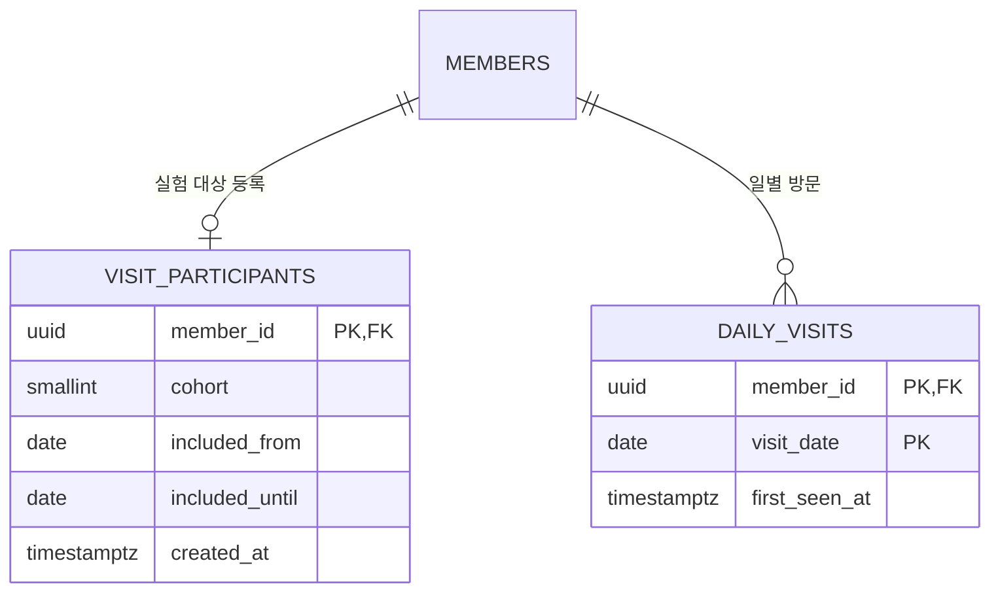

# IGLOO VILLAGE 접속 통계 설계 (검토 초안)

## 기준

- 로그인은 기존 Supabase Auth/`members`를 재사용한다. 재인증 기능은 만들지 않는다.
- 협업자 및 비참여자는 `visit_participants`에 등록하지 않아 집계와 기록에서 제외한다.
- 최초 비교군 다섯 명은 `cohort = 1`, 이후 참여자는 `cohort = 2, 3...`으로 관리한다.
- 참여는 동의 및 관리자 등록 후 시작한다. 임의로 전체 회원 기록을 수집하지 않는다.
- 한국시간(Asia/Seoul) 기준 날짜별 1회 방문 여부만 기록한다. 온라인 여부, 화면에 머문 시간, 로그인 횟수는 측정하지 않는다.
- 그래프에는 개별 회원 ID나 이름을 전달하지 않는다. 현재 조회 API는 승인 회원 전용이다.

## ERD 확장

`daily_visits`에 직접 `visit_participants` FK를 달지 않은 이유는 기존 회원과 참조하기 위해서다. 다만 RLS가 등록된 실험 대상자만 오늘 기록하도록 차단한다.

## API

- `await villageBackend.recordVisit()` → `boolean`: 등록된 참여자인 경우 `true`; 대상이 아니거나 아직 참여 전이면 `false`. 인증된 승인 회원만 호출한다.
- `await villageBackend.getVisitTrend(14)` → 최근 14일 자료 배열, 최대 90일. 승인 회원만 조회한다.

날짜별 응답 필드: `visit_date`, `baseline_total`, `baseline_active`, `baseline_rate`, `total_participants`, `total_active`, `total_rate`. 분모가 0인 날에는 rate가 `null`이다.

계산식: `baseline_rate = 100 * baseline_active / baseline_total`, `total_rate = 100 * total_active / total_participants`. 비교군과 전체군 모두 각 날짜 시점의 참여 시작일과 종료일을 반영한다.

## 프론트엔드 연동 경계

- 아직 `index.html`이나 `auth-ui.js`는 수정하지 않는다.
- 이후 프론트엔드에서 로그인 승인 회원의 마을 진입/재방문 시 `recordVisit()` 호출이 필요하다. 한 번 로그인하고 탭을 계속 켜 두는 경우에도 날짜가 바뀌면 새로운 기록이 필요하므로 적절한 재진입 이벤트를 선택한다.
- 그래프는 `getVisitTrend()`로 읽은 집계만 표시한다. 개인별 출석 표시나 참여자 이름은 노출하지 않는다.

## 실행 순서

1. 팀과 테이블 설계·데이터 수집 동의·보관 기간 및 그래프 공개 범위를 합의한다.
2. 로컬 코드에 `apply_visit_analytics.py` 적용 후 JavaScript 테스트를 실행한다.
3. 팀 승인 후 `visit-analytics.sql`을 **정확한 Supabase 프로젝트에** 운영 마이그레이션으로 적용한다.
4. `verify-visits.sql`로 RLS와 중복 방문 방지를 롤백 검증한다.
5. 관리자 권한으로 참여자 5명의 실제 `member_id`, cohort=1, 포함 시작일을 등록한다. 초대 코드·비밀 키는 저장소에 넣지 않는다.
6. 이후 프론트엔드 진입 지점과 그래프를 연결한다.

**주의:** 이미 존재하는 `backend/schema.sql` 전체를 실제 DB에 재실행하지 않는다. `visit-analytics.sql`만 신규 마이그레이션이다.
